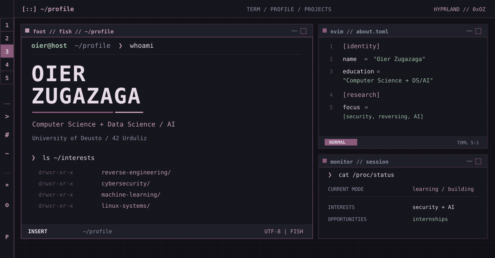
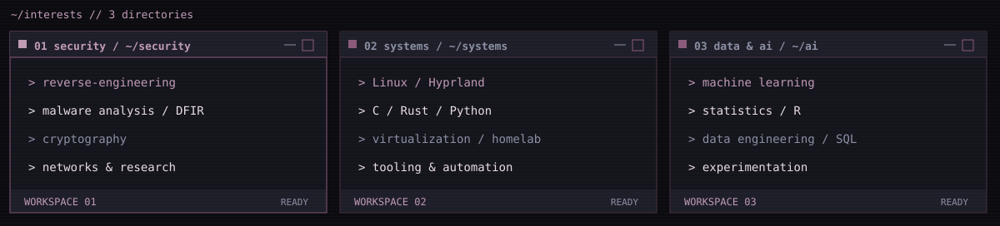
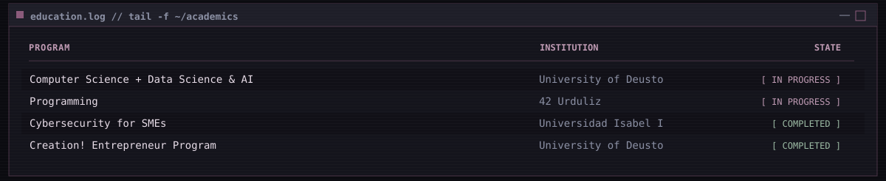
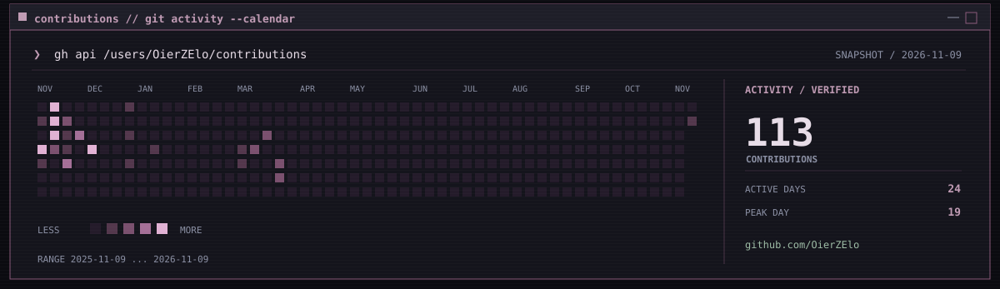
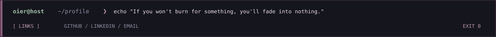

<!--
  OierZElo / OierZElo
  Retro Linux / Hyprland-inspired profile README.
  All imagery is self-hosted SVG: no public image generators or CSS hacks.
-->

  

  <a href="https://github.com/OierZElo?tab=repositories"><code>[ repositories ]</code></a>
  &nbsp;&nbsp;
  <a href="https://www.linkedin.com/in/oier-zugazaga/"><code>[ linkedin ]</code></a>
  &nbsp;&nbsp;
  <a href="mailto:oier.z@opendeusto.es"><code>[ email ]</code></a>

### `oier@host ~ $ cat about.txt`

I'm **Oier Zugazaga**, a **Computer Science + Data Science & AI** student at the **University of Deusto**, also learning through **42 Urduliz**. I enjoy understanding how systems work beneath the surface, especially **cybersecurity**, **reverse engineering**, **malware analysis**, **AI**, and **Linux**.

I'm open to **internship and research opportunities** and collaborate on AI-related activities at the University of Deusto.

### `oier@host ~ $ ls ~/interests`

  

<code>$ cat ~/toolkit.txt</code> &nbsp; / &nbsp; technologies and tools

| Domain | Toolkit and interests |
|:--|:--|
| Programming | Python · C · Rust · Java · R · SQL |
| Linux & systems | Arch Linux · Hyprland · Shell · Virtualization · Networking |
| Security | Reverse Engineering · Malware Analysis · Cryptography · DFIR |
| AI & data | Machine Learning · Data Science · Statistics |

### `oier@host ~ $ tail ~/education.log`

  

### `oier@host ~ $ ./contributions --calendar`

  

Activity snapshot verified against the [GitHub contributions calendar](https://github.com/users/OierZElo/contributions) on 2026-11-09. The SVG is stored in this repository and can be refreshed daily through the included GitHub Actions workflow. It shows public profile contributions, not a proficiency score.

### `oier@host ~ $ exit`

  <a href="https://github.com/OierZElo"><code>GITHUB</code></a>
  &nbsp;/&nbsp;
  <a href="https://www.linkedin.com/in/oier-zugazaga/"><code>LINKEDIN</code></a>
  &nbsp;/&nbsp;
  <a href="mailto:oier.z@opendeusto.es"><code>EMAIL</code></a>

  

